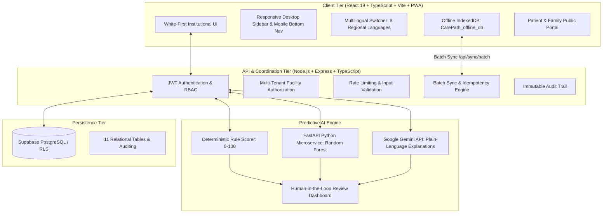

# CarePath AI - Predictive Patient Care Continuity & Recovery Network

> **Tagline:** *Every Patient Matters. Every Treatment Journey Counts.*

[](#-phase-10-verification--automated-tests)
[](#-offline-first-pwa--indexeddb)
[](#-predictive-ai-care-gap-intelligence)
[](#-multilingual-support)

CarePath AI is an institutional healthcare continuity platform that prevents patients from falling through the cracks of fragmented health systems. It bridges patient registration, longitudinal 8-stage care pathways, hybrid AI care-gap risk prediction, cross-facility specialist referrals, community follow-up task management, and offline Progressive Web App (PWA) field functionality.

---

## 🏛️ System Architecture



---

## 🌟 Core Modules & Capabilities

### 1. Patient Registration & Onboarding
- **Comprehensive Clinical Intake**: Full Name, DOB/Age, Gender, Contact number, Residential address, Preferred language, Assigned facility, and Informed consent status (`granted`, `pending`, `revoked`).
- **Unique Patient Reference ID**: Automatically generated as `CLP-2026-XXXX`.
- **Duplicate Detection**: Real-time telephone number and demographic checks before submission to prevent fragmented medical records.
- **Printable Patient Card**: Generates a physical counter card with a scannable QR code for patients without smartphones or email.

### 2. Patient Care Journey Engine
- **8 Longitudinal Stages**: Registration → Consultation → Lab Tests → Referral → Medicine Collection → Follow-up Appointment → Recovery Follow-up → Journey Completion.
- **Timeline & Document Attachments**: Visual progression bars with status flags (`Not Started`, `In Progress`, `Pending`, `Completed`, `Overdue`). Supports supporting document uploads (lab results, discharge slips).

### 3. Predictive AI Care-Gap Intelligence (Hybrid Approach)
- **Deterministic Rule Scoring (0–100)**: Transparent operational weights for missed appointments (+20), overdue referrals (+25), delayed follow-ups (+20), transit barriers (+15), and repeated delays (+10).
- **Machine Learning Microservice**: Python FastAPI service running a Scikit-learn Random Forest model predicting continuity failure risk within the next 7 days without data leakage across patient splits.
- **Google Gemini Integration**: Translates statistical risk features into simple plain-language operational summaries and drafts administrative outreach actions.
- **Human-in-the-Loop Guardrail**: Strictly non-diagnostic; clinicians review, accept, modify, or dismiss all AI suggestions.

### 4. Closed-Loop Follow-ups & Referrals
- **Contact Attempt Logging**: Tracks outreach attempts via Phone, SMS, and Home visits.
- **Systemic Barrier Categorization**: Documents patient barriers (*Transportation, Appointment availability, Language / Communication, Financial / Access*).
- **Cross-Facility Referral Liaison**: Tracks transfers between referring and receiving hospitals with automatic 48-hour delay escalation.

### 5. Multilingual & Regional Accessibility
- Full native UI translation across **8 Indian Languages**: English, Tamil (தமிழ்), Hindi (हिन्दी), Telugu (తెలుగు), Malayalam (മലയാളം), Kannada (ಕನ್ನಡ), Bengali (বাংলা), and Marathi (मराठी).
- Instant language switching without session logout; user preferred language persists in profile.

### 6. Offline-First Progressive Web Application (PWA)
- **Service Worker (`sw.js`) & Manifest (`manifest.json`)**: Cache-first static shell with network fallback.
- **IndexedDB Sync Queue (`offlineQueue.ts`)**: Captures offline task updates, milestone activities, and patient enrollments.
- **Idempotency & Version Conflict Resolution**: Server endpoint `POST /api/sync/batch` detects if server data was updated more recently and prevents silent overwrites.

### 7. Administrative Analytics & Compliance Reports
- **Live Institutional Metrics**: Total facilities, registered patients, active pathways, pending activities, overdue referrals, and follow-up completion rates.
- **Visual Analytics**: Registration trends, weekly activity distributions, care-gap categories, and cross-facility benchmarks.
- **Multi-Format Export**: One-click **CSV** data spreadsheet downloads and **PDF** print-ready compliance documents.

---

## 🚀 Getting Started Locally

### Prerequisites
- Node.js (v18+ recommended)
- Python (v3.10 - v3.14)
- npm

### 1. Clone & Install Dependencies
```powershell
# Clone the repository
git clone https://github.com/your-username/CarePathAI.git
cd CarePathAI

# Install Server dependencies
cd server
npm install

# Install Client dependencies
cd ../client
npm install

# Install Python ML dependencies
cd ../ml-service
pip install -r requirements.txt
```

### 2. Configure Environment Variables
Copy `.env.example` in each directory:
```powershell
# In root:
cp .env.example .env

# In server/:
cp server/.env.example server/.env

# In ml-service/:
cp ml-service/.env.example ml-service/.env
```

### 3. Run the Complete Stack
Open 3 terminal windows:

```powershell
# Terminal 1: Python ML Microservice (Port 8000)
cd e:\CarePathAI\ml-service
python -m uvicorn main:app --reload --port 8000

# Terminal 2: Node.js Express API Server (Port 5000)
cd e:\CarePathAI\server
npm run dev

# Terminal 3: React Vite Frontend (Port 5173)
cd e:\CarePathAI\client
npm run dev
```

Visit **`http://localhost:5173`** in your browser.

---

## 🧪 Phase 10 Verification & Automated Tests

To run the complete automated test suite verifying all 15 core architectural gates:

```powershell
cd e:\CarePathAI\server
npx tsx src/verifyPhase10.ts
```

### Test Gate Results (15/15 Passed):
| # | Test Area | Status | Verification Summary |
| :-: | :--- | :-: | :--- |
| **01** | Authentication & Login | ✅ PASS | JWT token issuance and credential verification |
| **02** | Role-Based Access Control (RBAC) | ✅ PASS | Permissions enforced across Physician, Coordinator, Admin |
| **03** | Facility-Level Multi-Tenancy | ✅ PASS | 0% cross-facility data leakage across institutional sites |
| **04** | Patient Creation & Editing | ✅ PASS | Unique `CLP-2026-XXXX` ID generation and field updates |
| **05** | Care Journey Creation | ✅ PASS | 8-stage longitudinal care timeline initialization |
| **06** | Activity Status & Audit Logging | ✅ PASS | Status transition recorded with actor ID and timestamp |
| **07** | Referral Management & Escalation | ✅ PASS | Inter-facility transfer, acknowledgment, and 48h escalation |
| **08** | Rule-Based Care-Gap Assessment | ✅ PASS | Deterministic scoring (0-100) with factor penalty breakdown |
| **09** | Gemini Non-Diagnostic Safety | ✅ PASS | Administrative guidance only; no clinical prescription |
| **10** | Follow-up & Barrier Tracking | ✅ PASS | Contact attempt logging and transit/financial barrier capture |
| **11** | Multilingual Translations | ✅ PASS | Verified static UI coverage across all 8 Indian languages |
| **12** | Mobile Responsiveness | ✅ PASS | Responsive viewport verification (bottom nav & modals) |
| **13** | Offline Sync Queue & Idempotency | ✅ PASS | UUID idempotency prevents duplicated batch sync execution |
| **14** | Version Conflict Detection | ✅ PASS | Server rejects older offline timestamps non-silently |
| **15** | PDF and CSV Export Generation | ✅ PASS | Verified aggregation payload for instant document download |

---

## ☁️ Deployment Guide

### A. Frontend Deployment (Vercel)
1. Push repository to GitHub.
2. In [Vercel Dashboard](https://vercel.com), click **Add New Project** and select `CarePathAI`.
3. Root Directory: `client` (or use the included root [vercel.json](file:///e:/CarePathAI/vercel.json)).
4. Build Command: `npm run build`
5. Output Directory: `dist`
6. Add Environment Variables:
   - `VITE_API_URL`: Your deployed Render backend URL (e.g. `https://CarePath-server.onrender.com`).
   - `VITE_SUPABASE_URL`: Your Supabase URL.
   - `VITE_SUPABASE_ANON_KEY`: Your Supabase public key.

### B. Backend Deployment (Render)
1. In [Render Dashboard](https://render.com), click **New Web Service**.
2. Connect your repository.
3. Root Directory: `server`
4. Environment: `Node`
5. Build Command: `npm install && npm run build`
6. Start Command: `npm start`
7. Add Environment Variables:
   - `PORT`: `10000`
   - `NODE_ENV`: `production`
   - `JWT_SECRET`: Secure generated secret.
   - `ML_SERVICE_URL`: Deployed Python ML service URL.
   - `GEMINI_API_KEY`: Google Gemini API key.
   - `SUPABASE_URL` & `SUPABASE_SERVICE_ROLE_KEY`.

### C. Python ML Service Deployment (Render)
1. In Render Dashboard, click **New Web Service**.
2. Root Directory: `ml-service`
3. Environment: `Python`
4. Build Command: `pip install -r requirements.txt`
5. Start Command: `uvicorn main:app --host 0.0.0.0 --port 10000`

### D. Database Setup (Supabase PostgreSQL)
1. Open the [Supabase SQL Editor](https://app.supabase.com).
2. Execute [database/schema.sql](file:///e:/CarePathAI/database/schema.sql) to create all 11 tables, enums, indexes, and Row Level Security (RLS) policies.
3. Execute [database/seed.sql](file:///e:/CarePathAI/database/seed.sql) to populate synthetic clinical demo data.

---

## 🔒 Security & Compliance Standards

- **Row Level Security (RLS)**: Enforced in PostgreSQL schema ensuring users only access rows permitted by their facility association and role.
- **In-Memory Rate Limiting**: Built into Express (`300 requests/minute/IP`) to guard against brute-force and DDoS attacks.
- **Non-Diagnostic Safety**: AI algorithms strictly support operational workflow continuity and care-process bottleneck prediction; no autonomous clinical diagnosis or drug prescription.
- **Synthetic Data Labeling**: All demo records, patients, and test hospitals are strictly synthetic and de-identified.
- **Data Minimization**: Offline storage in IndexedDB strictly excludes sensitive EHR free-text, caching only approved task IDs and status updates.

---

## 📄 License & Credits
CarePath AI was built for healthcare continuity resilience. Developed with high-fidelity React, Node.js, Scikit-learn, and Gemini.
